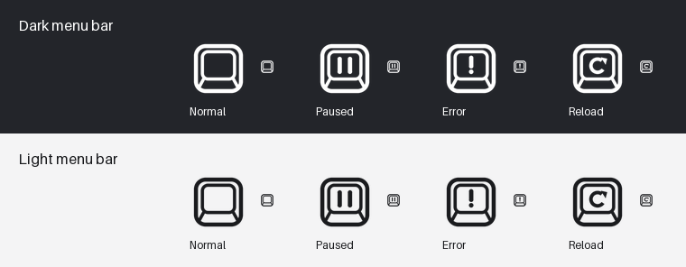

# kanata-tray

A simple wrapper for [kanata](https://github.com/jtroo/kanata) to control it from tray icon.
Works on Windows, Linux and macOS.

### Note: there's now Windows-only native tray app support in kanata ([https://github.com/jtroo/kanata/pull/990](https://github.com/jtroo/kanata/pull/990))

See [#24](https://github.com/rszyma/kanata-tray/issues/24) for comparison

## Features

- Tray icon for kanata, with start/stop/pause buttons.
- Easy switching between multiple kanata configurations from tray icon.
- Allow to set custom tray icons for active kanata layers.
- Blink icon on successful kanata config reload.
- Hooks (custom scripts/programs that will run before/after kanata start/stop)
- Support for running multiple kanata instances with different configurations at the same time.
- Works out-of-the box with no configuration, but can be configured with toml file.



The bundled status icons are keycap outlines. On macOS they are template images,
so the menu bar tints them to match its appearance. On Linux and Windows they are
drawn as-is, in white, so they suit dark panels and taskbars. If yours is light,
[override them](#overriding-status-icons).

## Configuration

Default config file will be autogenerated for you on the first run.
You can access it from from: `Click Tray Icon > Configure`.

Config file name is `kanata-tray.toml`.
Supported TOML version: 1.1.0

The config folder location:

- Linux `~/.config/kanata-tray`.
- Windows `C:\Users\<YourUsername>\AppData\Roaming\kanata-tray`
- macOS `$HOME/Library/Application\ Support/kanata-tray`

Alternatively, you can place your config file in the same folder as kanata-tray executable,
and it will be have higher priority than the global config in user folder.

Custom config directory location can be set with `KANATA_TRAY_CONFIG_DIR` environment variable.

### Examples

An example of customized configuration file:

```toml
'$schema' = 'https://raw.githubusercontent.com/rszyma/kanata-tray/main/doc/config_schema.json'

[general]
allow_concurrent_presets = false # (default: false)

# Optional TCP control server to listen for remote commands, such as stopping/starting a preset.
# Reference: https://github.com/rszyma/kanata-tray/blob/main/doc/control_server.md
control_server_enable = true # (default: false)

[defaults]
kanata_executable = '~/bin/kanata' # if empty or omitted, system $PATH will be searched.
kanata_config = '' # if empty or not omitted, kanata default config locations will be used.
tcp_port = 5829 # (default: 5829)
autorestart_on_crash = true # (default: false)

[defaults.hooks]
# Hooks allow running custom commands on specific events (e.g. starting preset).
# Reference: https://github.com/rszyma/kanata-tray/blob/main/doc/hooks.md

[defaults.layer_icons]
mouse = 'mouse.png'
qwerty = 'qwerty.ico'
'*' = 'other_layers.ico'

[presets.'main cfg']
kanata_config = '~/.config/kanata/test.kbd'
autorun = true
# kanata_executable = ''
# layer_icons = {  }
# tcp_port = 1234
# extra_args = ['-n', '-c=~/.config/kanata/another.kbd']
# extra_env = { MY_ENVVAR = "1" }

[presets.'test cfg']
kanata_config = '~/.config/kanata/test.kbd'

```

### Explanation

`presets` - a config item, that adds an entry to tray menu. Each preset can have different settings for running kanata with:
`kanata_config`, `kanata_executable`, `autorun`, `layer_icons`, `tcp_port`, `extra_args`, `extra_env`, `autorestart_on_crash`.

`preset.autorun` - whether a preset should automatically run at kanata-tray startup.
Possible values: `true`, `false`, or a string with more complex logic.
See [autorun documentation](./doc/presets_autorun.md) for details.
Disabled by default.

`preset.layer_icons` - maps kanata layer names to custom icons.
Custom icons should be placed in `icons` folder in config directory, next to `kanata-tray.toml`.
Accepted icon types on Linux are `.ico`, `.png`, `.jpg`; on Windows only `.ico` is supported.
You can assign an icon to special identifier `'*'` to change icon for other layers not specified in `[layer_icons]`.
See [template icons on macOS](#template-icons-on-macos) for icons that follow tinted-style appearance.

`preset.autorestart_on_crash` - when set to true, preset will automatically restart whenever kanata crashes.
In case of too rapid restarts (above 2 autorestarts / minute) this feature will be automatically disabled.

`defaults` - a config item, that allows to overwrite default values for all presets.
It accepts same configuration options that `presets` do.

`general.allow_concurrent_presets` - when enabled, allows running multiple presets at the same time.
When disabled, switching presets will stop currently running preset (if any).
Disabled by default.

Other notes:

- You can use `~` in `kanata_config`, `kanata_executable` and `extra_args` to substitute to your "home" directory.
- Paths starting with `.\` (on Windows) or `./` (on Linux and macOS) will reference files located in kanata-tray config directory.
- On Windows: make sure to surround paths with single-quotes `'` instead of double-quotes, otherwise paths will not work (because `\` would be treated as escape character).

### Overriding status icons

It's possible to customize looks of status icons - i.e. reload, idle, paused.

Similar to `icons` folder (layer icons), `status_icons` folder will be created
next to `kanata-tray.toml` if it doesn't exists. When first creating, it will
also populate with default icons. To override status icons, simply replace it
with other one of your choice.

- Accepted file types are the same as in `icons`.
- The filename prefix must match specifc status i.e. files must start with one of:
  "default", "crash", "pause", "live-reload".
- If there are multiple files matching the prefix, only one of them will be loaded,
  and others ignored. A file named exactly `<status>Template.<ext>` wins.

On first run the folder is filled with `defaultTemplate.ico`, `crashTemplate.ico`,
`pauseTemplate.ico` and `live-reloadTemplate.ico`. The `Template` suffix keeps
macOS tinting them.

Upgrading never touches the files already in this folder. If you have the old pink
`default.ico`, `crash.ico` and similar from an earlier version, they keep overriding
the new keycap icons. Delete or move them and restart the tray to switch.
[How the bundled icons are made](./doc/tinted_icons.md#bundled-keycap-icons).

### Template icons on macOS

On macOS, tinted-style icons are supported if the filename ends in `Template`. [Template icons documentation](./doc/tinted_icons.md).

### Hooks

Hooks allow running custom commands on specific events (e.g. starting preset).
[Hooks documentation](./doc/hooks.md).

### Config completion in editors

In VSCode to get editor support for your kanata-tray config, install [Even Better TOML](https://marketplace.visualstudio.com/items?itemName=tamasfe.even-better-toml#completion-and-validation-with-json-schema) extension and the following line at the top of your `kanata-tray.toml` file.

```toml
"$schema" = "https://raw.githubusercontent.com/rszyma/kanata-tray/main/doc/config_schema.json"
```

## Supported Kanata Versions

Minimal supported version of kanata is `v1.6.0`.

More specifically, builds after commit [010338b](https://github.com/jtroo/kanata/commit/010338b14d0020098b9263a615ef2152c249d666) (because it fixed an issue with TCP server)

## Troubleshooting

Log file - By default kanata-tray will try to write a log file named `kanata_tray_lastrun.log` in the same directory as itself. If it causes problems e.g. because of the location is read-only, the log directory can be changed by setting new path in `KANATA_TRAY_LOG_DIR` environment variable.

Debug logs - more verbose kanata-tray output, debug logging can be enabled with `--log-level=1` flag. You can use it to see loaded config struct or raw tcp messages from kanata.

## Linux Dependencies

None at runtime. kanata-tray uses [fyne.io/systray](https://github.com/fyne-io/systray),
which talks to the desktop over D-Bus with the StatusNotifierItem protocol. It does
not need GTK or libayatana-appindicator.

Your desktop does need a StatusNotifierItem host. KDE Plasma, Cinnamon, waybar and
most other panels have one built in. Stock GNOME needs the
[AppIndicator extension](https://extensions.gnome.org/extension/615/appindicator-support/).
Panels that only support the old XEmbed tray need a bridge such as `snixembed`.

Building from source needs only the Go version listed in `go.mod`, plus
[`just`](https://github.com/casey/just) if you use the recipes.

## Installation

Prebuild binaries for Windows and Linux: [releases page](https://github.com/rszyma/kanata-tray/releases/latest)

To build from source see recipes in [justfile](./justfile).

### Start automatically on macOS

Pick one of these. Two jobs that both start kanata will fight over the keyboard.

- [Start kanata-tray at login](./doc/macos-autostart.md). This page also covers
  moving off the setup from [#67](https://github.com/rszyma/kanata-tray/issues/67).
- [Start kanata at boot, without the tray](./doc/macos-kanata-daemon.md).

## Contributing

Unless explicitly stated otherwise, your contributions to this repository will be made under
[GNU General Public License v3.0 or later](https://spdx.org/licenses/GPL-3.0-or-later.html) license.
