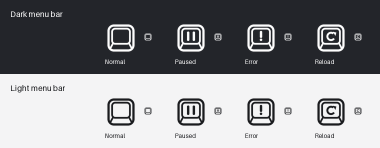

# Feature: template icons on macOS

On macOS, an icon whose filename ends with `Template` (before the extension) is set as a
[template image](https://developer.apple.com/documentation/appkit/nsimage/istemplate): macOS ignores its colors and tints the shape from the alpha channel, so it follows a light or dark menu bar the same way the system clock and Control Center icons do. Icons can be mixed freely; only the ones named `...Template` are tinted.

Such an icon should be monochrome (e.g. solid black) with a transparent background. Everything
that isn't transparent gets tinted, so a colored or fully opaque icon will show up as a solid
blob.

The color doesn't matter, only transparency does: white artwork is tinted the same as black.

It works for both layer icons and status icons:

```toml
[defaults.layer_icons]
mouse = 'mouseTemplate.png' # tinted to match the menu bar
qwerty = 'qwerty.png'       # used as-is
```

```
status_icons/
  defaultTemplate.png  # tinted
  pause.ico            # used as-is
```

For status icons, a `<status>Template.*` file takes precedence over a plain `<status>.*` one,
so there's no need to delete the default icons written on first run.

On Linux and Windows the `Template` suffix has no special meaning and such icons are drawn
as-is.

## Bundled keycap icons



| Status        | Look                                 |
| ------------- | ------------------------------------ |
| `default`     | Blank keycap                         |
| `pause`       | Keycap with two pause bars           |
| `crash`       | Keycap with an exclamation mark      |
| `live-reload` | Keycap with a circular arrow (shown briefly after a config reload) |

The artwork is white on a transparent background. The copies embedded in the binary
are always set as template images. The copies written to `status_icons/` on first run
are named `<status>Template.ico` so they keep that behavior. On Linux and Windows they
are drawn as-is, in white, which doesn't show up well on a light panel or taskbar.

### Regenerating

`scripts/generate-status-icons.py` is where the icons are defined. Everything else is
generated from it:

- `status_icons/*.ico`: 16, 32, 48, 64 and 128 px. The entries are stored as BMP rather
  than PNG because Windows' `LoadImage` needs BMP.
- `status_icons/128x128.png`
- `status_icons/sources/*.svg`: vector copies for reference. **Editing these does not
  change anything.** Change `SHELL` or `MARKS` in the script instead.
- `doc/assets/status-icons-preview.png`

Shapes are laid out on an 18×18 grid, the size of a macOS menu-bar icon. The script
draws them at 64× scale and shrinks them down, which keeps the small sizes smooth.

The script needs Pillow:

```sh
python3 -m venv /tmp/kanata-icons
/tmp/kanata-icons/bin/pip install Pillow
/tmp/kanata-icons/bin/python scripts/generate-status-icons.py
```

Then run `go test ./status_icons`. It checks that every icon decodes, is pure white
and has a transparent background.
